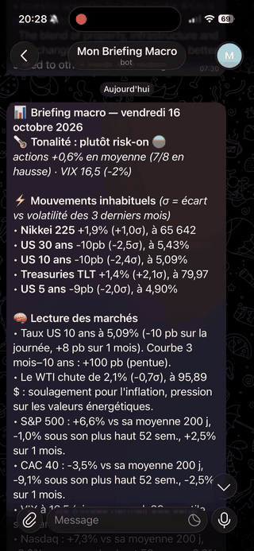
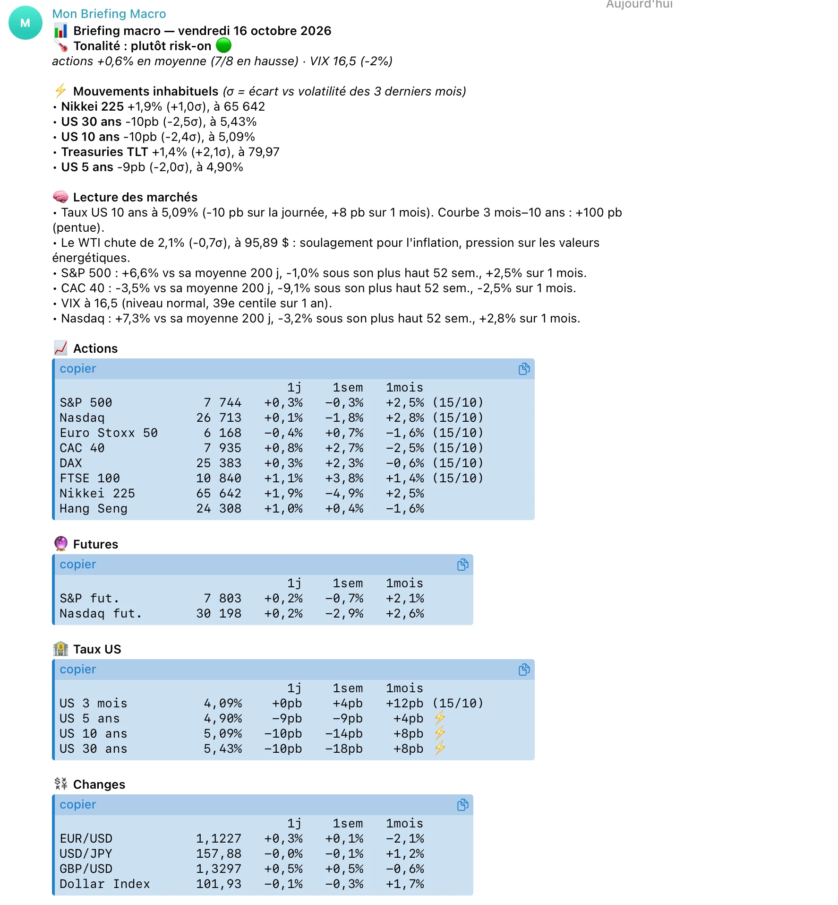
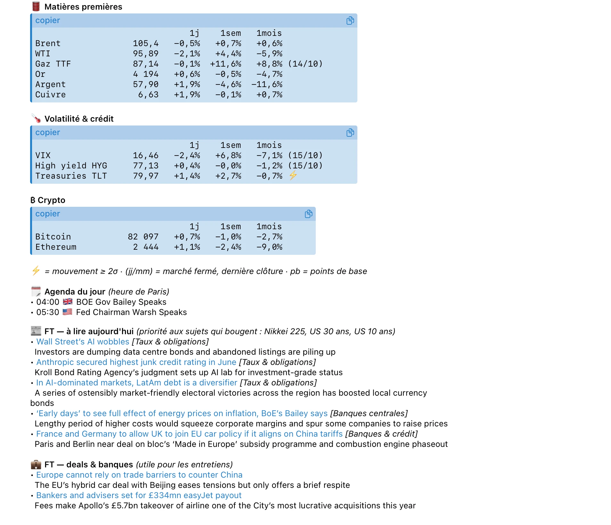

<h1 align="center">📈 Macro Bot</h1>

<p align="center">
  <strong>Briefing macro-financier quotidien, livré sur Telegram avant l'ouverture des marchés européens.</strong><br>
  Analyse 100 % calculée par règles, sans modèle de langage, sans serveur et sans API payante.
</p>

<p align="center">
  
  
  
  
</p>

<p align="center"></p>

## Sommaire

[Aperçu](#aperçu) · [Fonctionnalités](#fonctionnalités) · [Architecture](#architecture) · [Choix de conception](#choix-de-conception) · [Installation](#installation) · [Configuration](#configuration) · [Avertissement](#avertissement)

## Aperçu

Chaque jour ouvré, le bot envoie un message structuré : tonalité du marché, mouvements anormaux, lecture croisée des classes d'actifs, tableaux de bord chiffrés, agenda économique et articles à lire. Capture du briefing reçu le vendredi 16 octobre 2026 :

| Synthèse, mouvements inhabituels, actions, taux, changes | Matières premières, volatilité, crypto, agenda, presse |
|---|---|
|  |  |

## Fonctionnalités

| Rubrique | Contenu |
|---|---|
| **Tonalité du marché** | Score *risk-on / risk-off* transparent, avec les raisons chiffrées qui le justifient |
| **Mouvements inhabituels** | Variations mesurées en écarts-types (σ) par rapport à la volatilité des 3 derniers mois, avec des seuils absolus de secours par classe d'actifs |
| **Lecture des marchés** | Taux US et courbe 3 mois–10 ans, énergie, dollar, or, tendance des indices (moyenne 200 j, plus haut 52 semaines), VIX en centile, crédit high yield |
| **Tableau de bord** | Actions, futures, taux, changes, matières premières, volatilité, crypto (variation 1 jour, 1 semaine, 1 mois) |
| **Agenda économique** | Publications du jour et des 2 jours suivants, à l'heure de Paris |
| **Presse financière** | 5 articles classés par thème (banques centrales, taux, énergie, géopolitique…) et remontés quand ils expliquent un mouvement du jour, plus une rubrique deals & banques |

> **Traçabilité** : chaque conclusion du briefing repose sur des statistiques et des pondérations explicites. Aucune sortie n'est générée par un LLM.

## Architecture

```
GitHub Actions (cron + déclenchement externe)
        │
        ▼
  macro_bot.py ──► Yahoo Finance (yfinance)      cours et historiques
              ├──► Flux RSS publics du FT         titres et résumés
              ├──► Calendrier économique (JSON)   événements macro
              │
              ├─ compute_stats()   variations 1j/1s/1m, z-score du jour
              ├─ regime()          score risk-on / risk-off
              ├─ readings()        lecture croisée des marchés
              ├─ score_article()   pertinence des articles
              ▼
        Telegram Bot API  (messages découpés sous la limite de 4096 caractères)
```

**Stack** : Python 3.11 · `yfinance` · `requests` · GitHub Actions · Telegram Bot API

## Choix de conception

| Enjeu | Solution |
|---|---|
| **Détection pertinente** | Un mouvement de 1 % n'a pas la même signification sur le Nikkei et sur le VIX. Le z-score compare chaque actif à sa propre volatilité récente. |
| **Résilience** | Chaque rubrique est isolée (`safe()`). Si une source tombe, le reste du briefing part quand même. |
| **Anti-doublon** | `last_sent.txt` mémorise le dernier envoi. Le premier passage de la journée après 7 h (Paris) envoie le briefing, les suivants sont ignorés. Cela absorbe les retards des crons gratuits de GitHub, qui peuvent atteindre plusieurs heures. |
| **Concurrence** | Un seul passage à la fois (`concurrency` du workflow), pour éviter les doubles envois. |
| **Calendrier** | Aucun envoi le week-end (paramétrable). |

## Installation

1. **Fork ou clone** ce dépôt.
2. Crée un bot avec [@BotFather](https://t.me/BotFather) (`/newbot`) pour obtenir le token, puis récupère ton identifiant de chat en écrivant à ton bot.
3. Dans **Settings → Secrets and variables → Actions**, ajoute :
   - `TELEGRAM_BOT_TOKEN`
   - `TELEGRAM_CHAT_ID` (plusieurs identifiants possibles, séparés par des virgules)
4. Le workflow `Briefing Macro Quotidien` se déclenche automatiquement les jours ouvrés.

**Test en local**

```bash
pip install -r requirements.txt
DRY_RUN=1 python macro_bot.py      # affiche le briefing sans l'envoyer
```

**Test sur GitHub** : *Actions → Briefing Macro Quotidien → Run workflow*. Coche `dry_run` pour afficher le briefing dans les logs sans l'envoyer.

<details>
<summary><strong>Envoi à heure fixe (optionnel)</strong></summary>

Pour recevoir le briefing à 7 h 30 précises, déclenche le workflow depuis un service de cron externe (par exemple cron-job.org) :

- `POST https://api.github.com/repos/<ton-compte>/macro-bot/actions/workflows/daily-briefing.yml/dispatches`
- Corps : `{"ref":"main"}`
- En-tête `Authorization: Bearer <PAT>`, avec un *fine-grained token* limité à ce dépôt (permission **Actions : Read and write**)

Les crons GitHub restent actifs en secours.

</details>

## Configuration

Tout se règle en haut de `macro_bot.py` :

| Paramètre | Rôle |
|---|---|
| `GROUPS` | Actifs suivis (nom, ticker Yahoo, format d'affichage) |
| `SEND_FROM_HOUR`, `SEND_UNTIL_HOUR`, `SEND_WEEKENDS` | Fenêtre d'envoi |
| `ABS_THRESHOLD` | Seuils absolus par classe d'actifs |
| `THEMES`, `THEME_WEIGHT`, `FEED_WEIGHT`, `NOISE` | Critères de sélection des articles |

**Sécurité** : aucun secret n'est stocké dans le code, les identifiants Telegram sont fournis par les GitHub Secrets.

## Avertissement

Projet personnel à visée informative, qui ne constitue pas un conseil en investissement. Les données proviennent de sources publiques et peuvent être retardées ou incomplètes.
